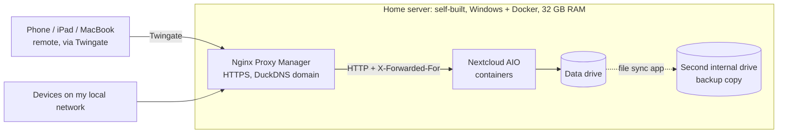

# Home Lab Server & Self-Hosted Nextcloud

A personal project (Apr 2026 – present). I built a home server from parts salvaged from old computers. It runs **Windows** with **Docker**, and hosts **Nextcloud All-in-One (AIO)** behind **Nginx Proxy Manager (NPM)**, which provides HTTPS using a free **DuckDNS** domain. The server is **private**: it is not exposed to the internet, and I reach it from anywhere only through **Twingate** (zero-trust remote access). My phone, iPad, and MacBook back up to it, and I maintain and manage the server myself.

**Status:** Active. The server runs on its own dedicated machine (separate from my other projects) and is still in use.

## Overview

The goal was to run my own file cloud instead of relying only on a third-party provider, and to learn hands-on how hardware, containers, a reverse proxy, private remote access, backups, and an application's security features fit together.

The most useful part was a real troubleshooting problem: while I was using Nextcloud on my local network, its brute-force protection started locking out legitimate logins because it could not see the real client IP address behind the proxy. Fixing it meant understanding how proxies forward client information and how an application decides which proxies to trust.

## What I built

- **Hardware:** a home server assembled from recycled parts from old computers, with 32 GB of RAM and a second internal drive for backups.
- **Host OS and containers:** Windows with Docker; Nextcloud AIO runs in containers.
- **Reverse proxy and HTTPS:** Nginx Proxy Manager in front of Nextcloud, using a free DuckDNS domain for HTTPS.
- **Private remote access:** Twingate zero-trust access, so I can reach the server from anywhere without exposing it publicly.
- **Device backups:** my phone, iPad, and MacBook back up to Nextcloud.
- **Server backup:** a file sync app copies the drive holding my Nextcloud data to a second internal drive in the same server.
- **Operations:** I maintain and manage the server on an ongoing basis.

## Stack

| Layer | Tool |
|---|---|
| Hardware | Self-built home server (recycled parts, 32 GB RAM, 2 internal drives) |
| Host OS | Windows |
| Containerization | Docker |
| Application | Nextcloud All-in-One (AIO) |
| Reverse proxy / HTTPS | Nginx Proxy Manager (NPM) with a free DuckDNS domain |
| Remote access | Twingate (zero-trust; no public exposure) |
| Backups | Devices back up to Nextcloud; file sync app copies the data drive to a second internal drive |

## Architecture



Text version:

```
Remote devices --(Twingate, private)--\
Local network devices -----------------> [ Home server: Windows + Docker ]
                                            Nginx Proxy Manager (HTTPS, DuckDNS domain)
                                               --X-Forwarded-For--> Nextcloud AIO --> data drive
                                                                                   --file sync--> second internal drive
No ports are exposed to the public internet; remote access is only through Twingate.
```

## Challenges and fixes

### 1. False brute-force throttling (on the local network)

**Problem:** While I was using Nextcloud on my local network, requests reached it through Nginx Proxy Manager, so Nextcloud logged every request as coming from the proxy container's internal IP instead of the real client IP. Nextcloud's built-in brute-force protection then saw many login attempts from "one" address and throttled legitimate logins.

**Fix:** I edited Nextcloud's `config.php` directly to tell it which proxy to trust and which header carries the original client IP, by setting `trusted_proxies` and `forwarded_for_headers`.

### 2. Proxy trust warnings

**Problem:** Nextcloud's *Security & setup warnings* panel flagged the reverse proxy configuration.

**Fix:** The same `config.php` change resolved the warnings, because Nextcloud now recognized the proxy as trusted.

### Example configuration (sanitized)

> **Example only.** The range below is a placeholder, not my real network. Use the subnet of your own Docker network that NPM runs on (you can check it with `docker network inspect <network-name>`).

```php
<?php
$CONFIG = array (
  // ...existing settings...

  // Trust the Docker network that Nginx Proxy Manager runs on (EXAMPLE range)
  'trusted_proxies' => array (
    0 => '172.18.0.0/16',
  ),

  // Read the real client IP from this header set by the proxy
  'forwarded_for_headers' => array (
    0 => 'HTTP_X_FORWARDED_FOR',
  ),
);
```

**Result:** Nextcloud now reads the real client IP addresses, false lockouts stopped, and the proxy warnings cleared.

## Lessons learned

- A reverse proxy changes what the application sees: without explicit trust settings, every user looks like the proxy.
- Security features (like brute-force protection) depend on correct network information; a misconfiguration can turn them against real users.
- Only trust the specific proxy network range, not "everything", so clients can't spoof the `X-Forwarded-For` header.
- Zero-trust access (Twingate) let me use the server from anywhere without opening it to the public internet.
- A copy on a second drive protects against one drive failing, but it sits in the same machine, so an off-site copy would protect against bigger problems.
- Older hardware is still useful: recycled parts make a capable always-on Docker host for learning and daily use.

## Next steps

The server is still running. Ongoing tasks:

- Keep the container images updated.
- Check that the drive-to-drive backup copy is current and can be restored.

## References

I followed and adapted these public tutorials. The setup in this repo is my own build (for example, I used Nginx Proxy Manager where the Twingate video uses Caddy, and I did not use Dockge). The videos are credited as learning resources only.

- [Nextcloud All In One On Docker On Windows Using Dockge](https://youtu.be/R4OEt3cdDVk) by KL Tech Videos
- [I Deployed a Secure Family Cloud Even My Parents Can Use](https://youtu.be/ewarxugZH3Q) by Twingate
- [Nextcloud All-in-One (official repository)](https://github.com/nextcloud/all-in-one)

## Screenshots

_Placeholders. I'll add my own photos and screenshots later (with domains, IPs, and usernames blurred):_

- [ ] The home server I built (photo of the hardware)
- [ ] Nginx Proxy Manager proxy host and SSL settings (domain hidden)
- [ ] Nextcloud AIO interface
- [ ] Twingate admin view (resource names and network details hidden)
- [ ] Nextcloud *Security & setup warnings* panel before and after the fix
