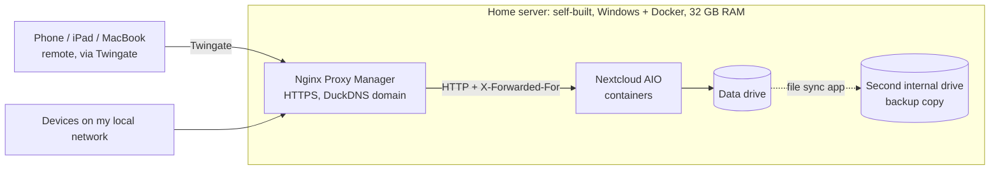
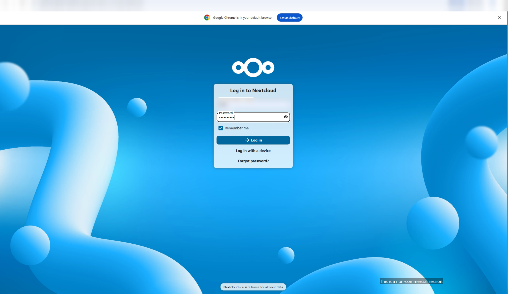
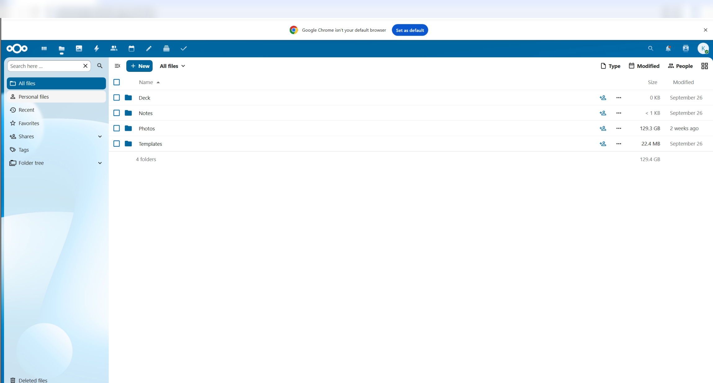
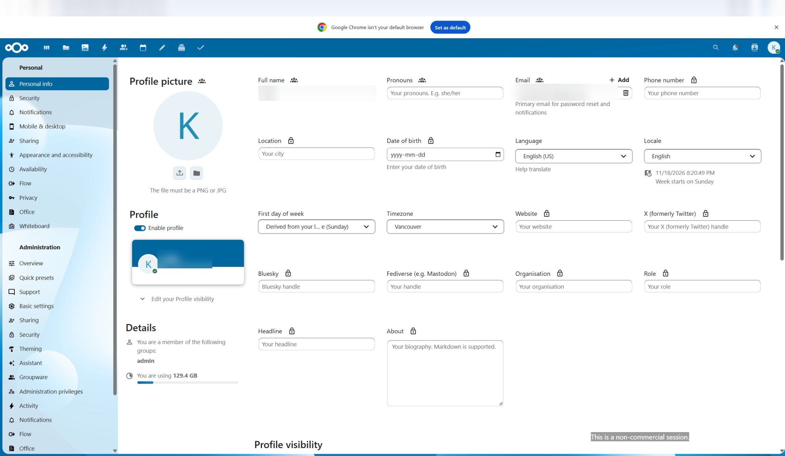
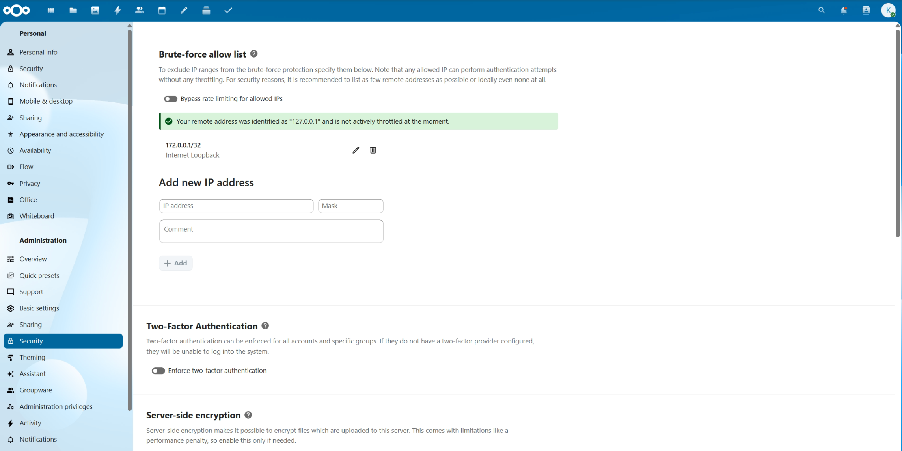
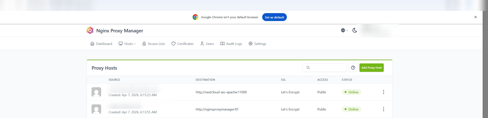
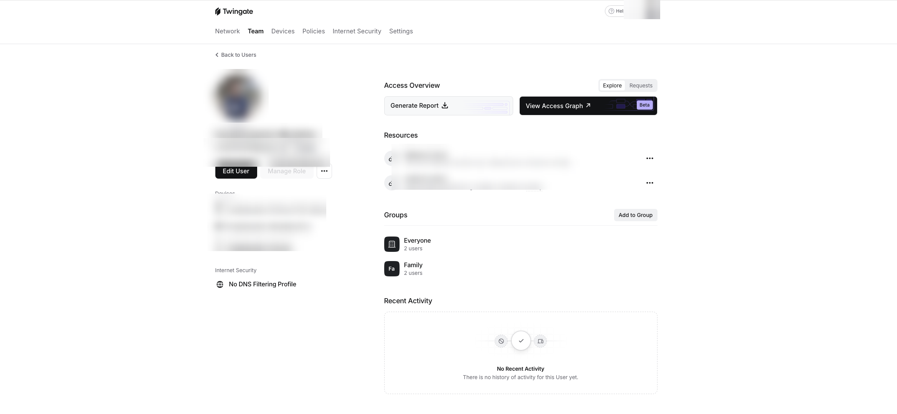

# Home Lab Server & Self-Hosted Nextcloud

A personal project (Apr 2026 – present). I built a home server from parts salvaged from old computers. It runs **Windows** with **Docker**, and hosts **Nextcloud All-in-One (AIO)** behind **Nginx Proxy Manager (NPM)**, which provides HTTPS using a free **DuckDNS** domain. The server is **private**: it is not exposed to the internet, and I reach it from anywhere only through **Twingate** (zero-trust remote access). My phone, iPad, and MacBook back up to it, and I maintain and manage the server myself.

**Status:** Active. The server runs on its own dedicated machine (separate from my other projects) and is still in use.

## Overview

The goal was to run my own file cloud instead of relying only on a third-party provider, and to learn hands-on how hardware, containers, a reverse proxy, private remote access, backups, and an application's security features fit together.

The most useful part was a real troubleshooting problem: while I was using Nextcloud on my local network, its brute-force protection started locking out legitimate logins because it could not see the real client IP address behind the proxy. Fixing it meant understanding how proxies forward client information and how an application decides which proxies to trust.

## What I built

- **Hardware:** a home server assembled from recycled parts from old computers, with 32 GB of RAM and a second internal drive for backups.
- **Host OS and containers:** Windows with Docker; Nextcloud AIO runs in containers.
- **Reverse proxy and HTTPS:** Nginx Proxy Manager in front of Nextcloud, using a free DuckDNS domain for HTTPS.
- **Private remote access:** Twingate zero-trust access, so I can reach the server from anywhere without exposing it publicly.
- **Device backups:** my phone, iPad, and MacBook back up to Nextcloud.
- **Server backup:** a file sync app copies the drive holding my Nextcloud data to a second internal drive in the same server.
- **Operations:** I maintain and manage the server on an ongoing basis.

## Stack

| Layer | Tool |
|---|---|
| Hardware | Self-built home server (recycled parts, 32 GB RAM, 2 internal drives) |
| Host OS | Windows |
| Containerization | Docker |
| Application | Nextcloud All-in-One (AIO) |
| Reverse proxy / HTTPS | Nginx Proxy Manager (NPM) with a free DuckDNS domain |
| Remote access | Twingate (zero-trust; no public exposure) |
| Backups | Devices back up to Nextcloud; file sync app copies the data drive to a second internal drive |

## Architecture



Text version:

```
Remote devices --(Twingate, private)--\
Local network devices -----------------> [ Home server: Windows + Docker ]
                                            Nginx Proxy Manager (HTTPS, DuckDNS domain)
                                               --X-Forwarded-For--> Nextcloud AIO --> data drive
                                                                                   --file sync--> second internal drive
No ports are exposed to the public internet; remote access is only through Twingate.
```

## Challenges and fixes

### 1. False brute-force throttling (on the local network)

**Problem:** While I was using Nextcloud on my local network, requests reached it through Nginx Proxy Manager, so Nextcloud logged every request as coming from the proxy container's internal IP instead of the real client IP. Nextcloud's built-in brute-force protection then saw many login attempts from "one" address and throttled legitimate logins.

**Fix:** I edited Nextcloud's `config.php` directly to tell it which proxy to trust and which header carries the original client IP, by setting `trusted_proxies` and `forwarded_for_headers`.

### 2. Proxy trust warnings

**Problem:** Nextcloud's *Security & setup warnings* panel flagged the reverse proxy configuration.

**Fix:** The same `config.php` change resolved the warnings, because Nextcloud now recognized the proxy as trusted.

### Example configuration (sanitized)

> **Example only.** The range below is a placeholder, not my real network. Use the subnet of your own Docker network that NPM runs on (you can check it with `docker network inspect <network-name>`).

```php
<?php
$CONFIG = array (
  // ...existing settings...

  // Trust the Docker network that Nginx Proxy Manager runs on (EXAMPLE range)
  'trusted_proxies' => array (
    0 => '172.18.0.0/16',
  ),

  // Read the real client IP from this header set by the proxy
  'forwarded_for_headers' => array (
    0 => 'HTTP_X_FORWARDED_FOR',
  ),
);
```

**Result:** Nextcloud now reads the real client IP addresses, false lockouts stopped, and the proxy warnings cleared.

## Lessons learned

- A reverse proxy changes what the application sees: without explicit trust settings, every user looks like the proxy.
- Security features (like brute-force protection) depend on correct network information; a misconfiguration can turn them against real users.
- Only trust the specific proxy network range, not "everything", so clients can't spoof the `X-Forwarded-For` header.
- Zero-trust access (Twingate) let me use the server from anywhere without opening it to the public internet.
- A copy on a second drive protects against one drive failing, but it sits in the same machine, so an off-site copy would protect against bigger problems.
- Older hardware is still useful: recycled parts make a capable always-on Docker host for learning and daily use.

## Next steps

The server is still running. Ongoing tasks:

- Keep the container images updated.
- Check that the drive-to-drive backup copy is current and can be restored.

## References

I followed and adapted these public tutorials. The setup in this repo is my own build (for example, I used Nginx Proxy Manager where the Twingate video uses Caddy, and I did not use Dockge). The videos are credited as learning resources only.

- [Nextcloud All In One On Docker On Windows Using Dockge](https://youtu.be/R4OEt3cdDVk) by KL Tech Videos
- [I Deployed a Secure Family Cloud Even My Parents Can Use](https://youtu.be/ewarxugZH3Q) by Twingate
- [Nextcloud All-in-One (official repository)](https://github.com/nextcloud/all-in-one)

## Screenshots

_All screenshots are from my own server. Domains, IP addresses, emails, usernames, and device names are blurred._


*Nextcloud login page served over HTTPS through Nginx Proxy Manager.*


*My Nextcloud Files view, where my phone, iPad, and MacBook back up.*


*Nextcloud personal settings (account details blurred).*


*Nextcloud brute-force allow list and protection settings.*


*Nginx Proxy Manager proxy hosts forwarding to the Nextcloud AIO Apache container.*


*Twingate admin view: private, zero-trust remote access to the server (user and device details blurred).*

---

## Setup Guide: Host Your Own Nextcloud with Docker

This is a step-by-step version of my setup that you can follow on your own Windows machine. It uses **Docker Desktop (WSL2)**, **Nextcloud All-in-One (AIO)**, **Nginx Proxy Manager** as the reverse proxy, a free **DuckDNS** subdomain with a **Let's Encrypt** certificate, and **Twingate** for private remote access, so you don't need to open any ports on your router.

> All names and addresses below are placeholders: `yourname.duckdns.org`, `192.168.x.x`, `<your-token>`. Replace them with your own values, and never commit real tokens or passwords to GitHub.

### Prerequisites

- A Windows 10/11 PC that can stay on (8 GB RAM minimum is a sensible start; I use 32 GB).
- A data drive for Nextcloud files, and ideally a **second internal drive** for backups.
- A **static/reserved local IP** for the server (set a DHCP reservation in your router), e.g. `192.168.x.x`.
- Free accounts at [DuckDNS](https://www.duckdns.org) and [Twingate](https://www.twingate.com).
- Ports **80** and **443** free on the PC (nothing else, like IIS, using them).

### Step 1: Install Docker Desktop

1. Install [Docker Desktop for Windows](https://www.docker.com/products/docker-desktop/) and keep the default **WSL 2 backend**.
2. Open Docker Desktop, then check it works in Command Prompt:

   ```cmd
   docker version
   docker compose version
   ```

3. In Docker Desktop settings, turn on **Start Docker Desktop when you sign in**. Docker Desktop only runs while a user is signed in, so plan for that (for example, auto sign-in on a dedicated server).

### Step 2: Get a free DuckDNS subdomain

1. Sign in at [duckdns.org](https://www.duckdns.org), create a subdomain such as `yourname`, and copy your **token**.
2. Because the server stays private, point the subdomain at the server's **local** IP. You can type it into the DuckDNS page, or use the update URL (from the [DuckDNS spec](https://www.duckdns.org/spec.jsp)):

   ```text
   https://www.duckdns.org/update?domains=yourname&token=<your-token>&ip=192.168.x.x
   ```

   You should get back `OK`.

### Step 3: Run Nginx Proxy Manager

1. Create a folder such as `C:\docker\npm` and save this as `docker-compose.yml` (based on the [official NPM setup](https://nginxproxymanager.com/setup/)):

   ```yaml
   services:
     app:
       image: 'jc21/nginx-proxy-manager:latest'
       restart: unless-stopped
       ports:
         - '80:80'    # HTTP
         - '443:443'  # HTTPS
         - '81:81'    # Admin web UI (keep this on your LAN only)
       environment:
         TZ: "America/Vancouver"
       volumes:
         - ./data:/data
         - ./letsencrypt:/etc/letsencrypt
   ```

2. Start it from that folder:

   ```cmd
   cd C:\docker\npm
   docker compose up -d
   ```

3. Open `http://192.168.x.x:81`.
   - **Current versions (2.13.0 and newer)** open a setup wizard where you create your own admin account. There is no default password.
   - **Older versions (2.12.x and earlier)** use the default login `admin@example.com` / `changeme`. **Change the email and password immediately.**
   - Never forward port 81 to the internet.

### Step 4: Start the Nextcloud AIO master container (reverse-proxy mode)

From the [official AIO reverse proxy docs](https://github.com/nextcloud/all-in-one/blob/main/reverse-proxy.md) (Windows command). Run it in **Command Prompt** (the `^` is the line-continuation character):

```cmd
docker run ^
--init ^
--sig-proxy=false ^
--name nextcloud-aio-mastercontainer ^
--restart always ^
--publish 8080:8080 ^
--env APACHE_PORT=11000 ^
--env APACHE_IP_BINDING=0.0.0.0 ^
--env APACHE_ADDITIONAL_NETWORK="" ^
--env SKIP_DOMAIN_VALIDATION=true ^
--env NEXTCLOUD_DATADIR="/run/desktop/mnt/host/d/ncdata" ^
--volume nextcloud_aio_mastercontainer:/mnt/docker-aio-config ^
--volume //var/run/docker.sock:/var/run/docker.sock:ro ^
ghcr.io/nextcloud-releases/all-in-one:latest
```

What the important lines do:

- `APACHE_PORT=11000`: Nextcloud listens on host port 11000, and Nginx Proxy Manager forwards to it.
- `APACHE_IP_BINDING=0.0.0.0`: needed because NPM reaches Nextcloud by IP address rather than `localhost`.
- `SKIP_DOMAIN_VALIDATION=true`: AIO normally checks your domain from the public internet. That check can't pass on a private, Twingate-only setup with no open ports, so it's skipped. Only do this once everything else is configured correctly.
- `NEXTCLOUD_DATADIR`: **optional**. It stores your files in a normal folder (here `D:\ncdata`) so they're easy to back up. It must be set **before** the first install and only works with internal drives. Leave it out to use a Docker volume instead.
- Don't change the container name or the `nextcloud_aio_mastercontainer` volume name; AIO updates and backups depend on them.

### Step 5: Get a Let's Encrypt certificate in NPM (DNS challenge)

There are no open ports, so use the **DNS challenge** instead of the normal HTTP check.

1. In NPM, go to **SSL Certificates → Add SSL Certificate → Let's Encrypt**.
2. Domain: `yourname.duckdns.org`.
3. Turn on **Use a DNS Challenge**, choose **DuckDNS**, and enter:

   ```ini
   dns_duckdns_token=<your-token>
   ```

4. If it times out, raise **Propagation Seconds** to about `120` and try again.

### Step 6: Add the proxy host in NPM

1. Go to **Hosts → Proxy Hosts → Add Proxy Host**:
   - Domain name: `yourname.duckdns.org`
   - Scheme: `http`
   - Forward hostname/IP: `192.168.x.x` (the server's local IP)
   - Forward port: `11000`
   - Turn on **Websockets Support**
2. **SSL** tab: pick the certificate from Step 5, and turn on **Force SSL** and **HTTP/2**.
3. **Advanced** tab: paste the settings the AIO docs recommend for NPM:

   ```nginx
   proxy_buffering off;
   proxy_request_buffering off;
   proxy_read_timeout 3610s;
   client_max_body_size 0;
   ```

### Step 7: Finish the AIO setup

1. Open the AIO interface at `https://192.168.x.x:8080`. Use the **IP address, not the domain**, and accept the self-signed certificate warning.
2. Save the **passphrase** it shows somewhere safe (a password manager).
3. Enter `yourname.duckdns.org` as your domain, choose optional apps, and click **Download and start containers**.
4. When it finishes, open `https://yourname.duckdns.org` and log in with the admin password shown in the AIO interface.

### Step 8: Fix the proxy IP (trusted_proxies)

If you get login throttling or a reverse-proxy warning under **Administration settings → Overview**, Nextcloud is seeing the proxy's IP instead of the real client IP. This happened to me on my local network.

1. Find the IP the proxy connects from. A good place to look is the failed-login entries in **Administration settings → Logging**. On Docker Desktop it's often a Docker-internal address such as `172.x.x.x`.
2. Add it as a trusted proxy. The AIO docs' `occ` command (run in Command Prompt, without `sudo`):

   ```cmd
   docker exec --user www-data -it nextcloud-aio-nextcloud php occ config:system:set trusted_proxies 2 --value=172.18.0.0/16
   ```

3. Or edit `config.php` directly, like I did. See the sanitized example in **Example configuration (sanitized)** above. Set `trusted_proxies` to your proxy's IP or range, and `forwarded_for_headers` to `HTTP_X_FORWARDED_FOR`. Make a backup copy of `config.php` before editing it.

### Step 9: Private remote access with Twingate (no port forwarding)

1. In the Twingate Admin Console, create a **Remote Network** (for example "Home").
2. Add a **Connector** and copy the deployment command it generates (it contains your tokens; keep it private). For Windows, Twingate [recommends](https://www.twingate.com/docs/connectors) running the Connector in a **Linux VM (Hyper-V)**. It also runs as a Docker container on Docker Desktop, but stops whenever the Windows user signs out.
3. Add a **Resource** for `yourname.duckdns.org` (or `192.168.x.x`) and give your user access.
4. Install the Twingate app on your phone, tablet, and laptop and sign in. Your devices can now reach `https://yourname.duckdns.org` from anywhere, and nothing is exposed to the public internet.

> **Optional, not recommended:** forwarding ports 80/443 on your router would make Nextcloud public. If you do that, you don't need `SKIP_DOMAIN_VALIDATION=true`, but you take on much more security risk.

### Step 10: Back up your data

1. **Device backups:** install the Nextcloud app on your phone, iPad, and computer and turn on automatic upload / folder sync.
2. **Drive-to-drive copy:** use a file sync tool to copy the Nextcloud data folder to the second internal drive. For a consistent copy, stop the containers in the AIO interface first, then start them again afterwards. One built-in Windows option is `robocopy`:

   ```cmd
   robocopy D:\ncdata E:\ncdata-backup /MIR /R:2 /W:5
   ```

   Careful: `/MIR` makes the backup an exact mirror, so files deleted from the source are deleted from the backup too.
3. **Off-site copy (recommended):** a second drive in the same PC won't survive theft, fire, or ransomware. Keep another copy somewhere else, for example an external drive stored elsewhere or AIO's built-in BorgBackup to a remote location.
4. Test a restore now and then.

### Troubleshooting

- **AIO interface won't load:** use `https://<IP>:8080` (not the domain), and accept the self-signed certificate.
- **502 Bad Gateway in NPM:** check the forward IP and port `11000`, and that the Nextcloud containers are running in the AIO interface.
- **Domain doesn't load at home:** some routers block public domains that point to private IPs (DNS rebind protection). Allow `duckdns.org` in the router settings, or connect through Twingate.
- **DuckDNS certificate fails:** increase Propagation Seconds to 120. Ad-blocking DNS (Pi-hole/AdGuard) rewriting your DuckDNS name can also break the challenge.
- **Logs:** `docker logs nextcloud-aio-mastercontainer`, and `docker compose logs -f` in the NPM folder.

Official docs: [Nextcloud AIO](https://github.com/nextcloud/all-in-one) · [AIO reverse proxy guide](https://github.com/nextcloud/all-in-one/blob/main/reverse-proxy.md) · [Nginx Proxy Manager](https://nginxproxymanager.com/setup/) · [DuckDNS](https://www.duckdns.org/spec.jsp) · [Twingate Connectors](https://www.twingate.com/docs/connectors)
