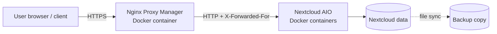

# Self-Hosted Nextcloud AIO Behind Nginx Proxy Manager

A personal project (Apr 2026 – present) where I deployed a self-hosted, containerized **Nextcloud All-in-One (AIO)** instance with **Docker**, exposed it securely over **HTTPS** through **Nginx Proxy Manager (NPM)**, with backups handled by a file sync app.

**Status:** Active. The server runs on its own dedicated machine (separate from my other projects) and is still in use.

## Overview

The goal was to run my own file-cloud service instead of relying only on a third-party provider, and to learn how a reverse proxy, containers, and an application's security features interact in practice.

The most useful part of the project was a real troubleshooting problem: Nextcloud's brute-force protection was locking out legitimate logins because it could not see the real client IP address behind the proxy. Fixing it meant understanding how proxies forward client information and how an application decides which proxies to trust.

## Stack

| Layer | Tool |
|---|---|
| Application | Nextcloud All-in-One (AIO) |
| Containerization | Docker |
| Reverse proxy / TLS | Nginx Proxy Manager (NPM) |
| Backups | File sync app |
| Host | Dedicated, separate machine (always on) |

## Architecture



Text version:

```
Client --HTTPS--> Nginx Proxy Manager (container) --X-Forwarded-For--> Nextcloud AIO (containers) --> data --file sync--> backup copy
```

## Challenges and fixes

### 1. False brute-force throttling

**Problem:** All external traffic passed through Nginx Proxy Manager, so Nextcloud logged every request as coming from the proxy container's internal Docker IP instead of the real client IP. Nextcloud's built-in brute-force protection then saw many login attempts from "one" address and throttled legitimate users.

**Fix:** I edited Nextcloud's `config.php` directly to tell it which proxy to trust and which header carries the original client IP, by setting `trusted_proxies` and `forwarded_for_headers`.

### 2. Proxy trust warnings

**Problem:** Nextcloud's *Security & setup warnings* panel flagged the reverse proxy configuration.

**Fix:** The same `config.php` change resolved the warnings, because Nextcloud now recognized the proxy as trusted.

### Example configuration (sanitized)

> **Example only.** The range below is a placeholder, not my real network. Use the subnet of your own Docker network that NPM runs on (you can check it with `docker network inspect <network-name>`).

```php
<?php
$CONFIG = array (
  // ...existing settings...

  // Trust the Docker network that Nginx Proxy Manager runs on (EXAMPLE range)
  'trusted_proxies' => array (
    0 => '172.18.0.0/16',
  ),

  // Read the real client IP from this header set by the proxy
  'forwarded_for_headers' => array (
    0 => 'HTTP_X_FORWARDED_FOR',
  ),
);
```

**Result:** Nextcloud now reads the real client IP addresses, false lockouts stopped, and the proxy warnings cleared.

## Lessons learned

- A reverse proxy changes what the application sees: without explicit trust settings, every user looks like the proxy.
- Security features (like brute-force protection) depend on correct network information; a misconfiguration can turn them against real users.
- Only trust the specific proxy network range, not "everything", so clients can't spoof the `X-Forwarded-For` header.
- Keeping a separate backup copy (in my case with a file sync app) matters, and it should be checked regularly to make sure it can actually be restored.

## Next steps

- The server is still running. Ongoing tasks:
- Periodically verify backup integrity in the Nextcloud AIO interface.
- Keep the container images updated.

## Screenshots

_Placeholders. I'll add these later (with any domains, IPs, and usernames blurred):_

- [ ] Nginx Proxy Manager proxy host and SSL settings
- [ ] Nextcloud AIO interface
- [ ] Nextcloud *Security & setup warnings* panel before and after the fix
